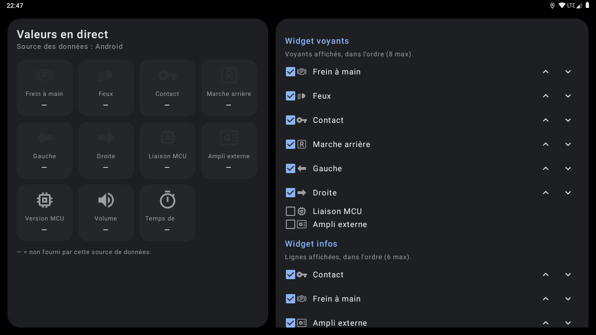
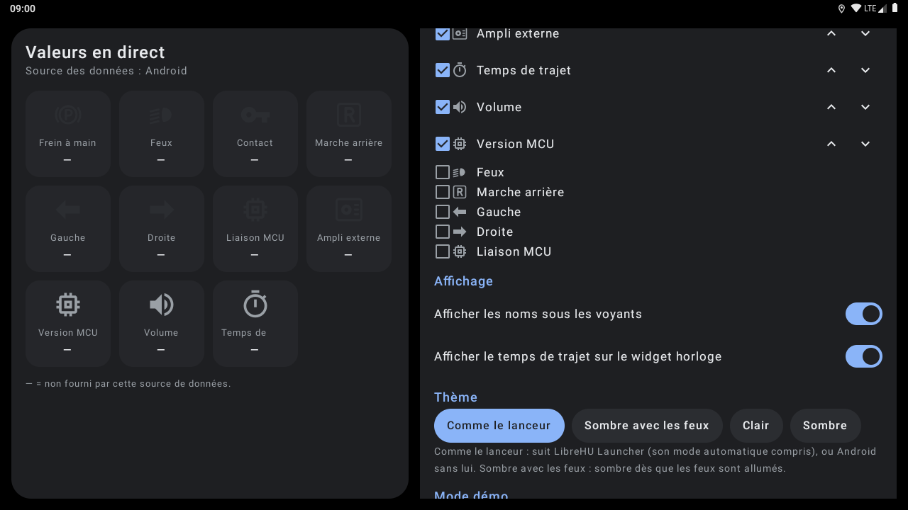
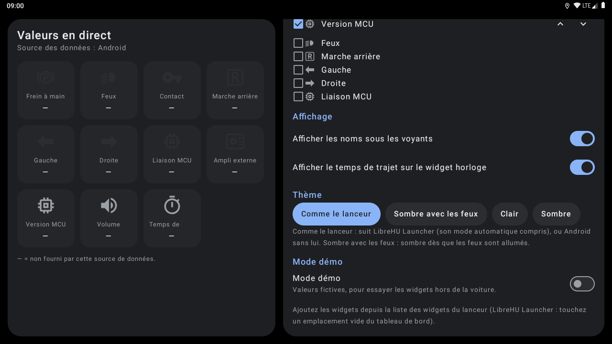

# LibreHU Widgets

Plusieurs widgets d'écran d'accueil dans un seul APK, pour autoradios Jancar / Autochips AC8257 (UJC201), avec une
app de configuration. Thème clair / sombre automatique, comme les autres applis LibreHU.

| Widget | Contenu |
|---|---|
| **Voyants** | rangée de voyants qui s'allument : frein à main (rouge), feux, contact, marche arrière, clignotants, liaison MCU, **ampli externe** (sortie REM) — choix et ordre réglables |
| **Horloge** | heure, date et **temps de trajet** depuis la mise du contact (chronomètre) |
| **Infos** | liste de valeurs : contact, frein à main, ampli externe, temps de trajet, volume, version MCU… — choix et ordre réglables |
| **Voyant unique** | un grand voyant ou une valeur, choisi en posant le widget |

L'app **Widgets LibreHU** montre les valeurs en direct (« sondes »), règle ce que chaque widget affiche, le thème
(comme le lanceur, sombre avec les feux, clair, sombre) et un **mode démo** pour essayer hors de la voiture.
Un service au premier plan (notification discrète) tient les widgets à jour.

## Captures d'écran

| | |
|---|---|
|  Écran principal |  Écran principal (2) |
|  Écran principal (3) |   |

Captures sur l'émulateur Android 9 (1280×720, 160 dpi comme l'autoradio), sans autoradio branché : les valeurs du véhicule et de la MCU sont vides. Refaites-les avec l'action **Screenshots** de [LibreHU-OTA-app](https://github.com/LibreHU/LibreHU-OTA-app/tree/main/screenshots). Galerie : [librehu.github.io/screenshots/widgets.html](https://librehu.github.io/screenshots/widgets.html).

## Branches

| Branche | Source des données |
|---|---|
| `main` | aucune (Android générique) : horloge seulement, voyants « — » ; mode démo |
| `ivi` | Jancar **ivi-services** : `ICar` (frein à main, marche arrière, feux, clignotants, version MCU), contact (`Settings.Global accStatus`), volume (`IAudio`) |
| `librehu-service` | [LibreHU-service](https://github.com/LibreHU/LibreHU-service) : indicateurs véhicule, version MCU, volume |

Le thème suit [LibreHU Launcher](https://github.com/LibreHU/LibreHU-Launcher-App) (y compris son mode
automatique selon les feux et sa **couleur d'accent** : heure, icônes, titres des widgets et app de réglages) ; sans lui, le thème sombre d'Android.

Non testé sur l'autoradio à ce stade.

## Appli téléphone (LibreHU Bridge)

Réglable depuis le téléphone par l'appli LibreHU Bridge (Android et iPhone), à travers LibreHU-service : chaque place des widgets Voyants et Infos, noms, temps de trajet, thème et démo.
Fournisseur `<paquet>.bridge` (`bridge/BridgeProvider.kt`), réservé aux applis signées avec la clé LibreHU (permission
`org.librehu.permission.BRIDGE`, vérifiée dans `call()` lui-même) ; format décrit dans
[LibreHU-service, docs/bridge.md](https://github.com/LibreHU/LibreHU-service/blob/main/docs/bridge.md).

## Optimisation (R8)

L'APK publié par la CI (`assembleRelease`) est **optimisé par R8** : code et ressources réduits et optimisés, ce qui
rend Jetpack Compose nettement plus fluide ([Compose performance](https://developer.android.com/develop/ui/compose/performance)),
**sans renommage** (`-dontobfuscate` dans `app/proguard-rules.pro`) : les traces des journaux restent lisibles. Les
règles gardent aussi ce qui n'est appelé que par son nom (méthodes natives, helpers root lancés par `app_process`). Si
une fonction plante avec « class / method not found », regarder `usage.txt` dans l'artefact *R8 reports* de la CI (ce
que R8 a retiré) et ajouter une règle `-keep`.

**Styles Modularer Infotainment-Baukasten et LHU-Link de LibreHU Launcher** : c'est le launcher qui les choisit et les demande à l'appli (il publie `style` = `factory` ou `ambient`, comme pour le style rétro) ; l'appli suit tout de suite : palette noire du style même en mode jour, coins carrés partout, police Source Sans 3 pour Modularer Infotainment-Baukasten (SIL OFL 1.1, `third_party/SourceSans3-LICENSE.md`), lettres fines pour LHU-Link. Rien à régler dans l'appli.

**Style rétro et police de LibreHU Launcher** : quand le launcher est en style rétro (les couleurs d'un afficheur
d'autoradio tirées de sa couleur d'accent, couleur RGB comprise), cette appli prend sa palette (jour ou nuit) ; quand
la **police d'afficheur à segments** y est choisie (dans tous les styles), cette appli la prend aussi, en majuscules
sans accents (« LibreHU Seg14 », tirée de DSEG14 © keshikan, SIL Open Font License 1.1, voir
`third_party/DSEG-LICENSE.txt`). Le launcher publie le style, la police et la palette par
`content://org.librehu.launcher.theme/theme` (colonnes `style`, `font`, `background`, `surface`, `surface_high`,
`on_accent`, `text`, `text_dim`) et par la diffusion `org.librehu.action.THEME_CHANGED` (mêmes noms en extras).

**Widgets** : mêmes couleurs rétro et même police. Un widget Android 9 ne peut pas utiliser la police d'une appli
(TextView ne charge pas de police dans le contexte restreint de l'écran d'accueil) : avec la police à segments, chaque
texte est dessiné en image (`SegmentViews` : le TextView lui-même, avec la police à segments, mis en page à la
taille du widget, donc coupé avec « … », aligné et sur ses lignes comme d'habitude) et affiché par une ImageView
`<id>_seg` placée comme lui, ajoutée à côté de
chaque texte des layouts `widget*.xml` par `tools/segment_widgets.py` (à relancer après avoir modifié un layout de
widget). Les fonds rétro sont des couleurs unies (Android 9 ne teinte pas un fond de widget ; la case arrondie du
launcher les découpe). L'horloge est redessinée pile au changement de minute.

## Soutenir le projet

LibreHU est développé bénévolement, sur le temps libre, et toutes ses applis restent gratuites. Si le projet vous est
utile, vous pouvez le soutenir par un don sur [Liberapay](https://liberapay.com/DokT/donate) (association française à
but non lucratif, dons récurrents) :

